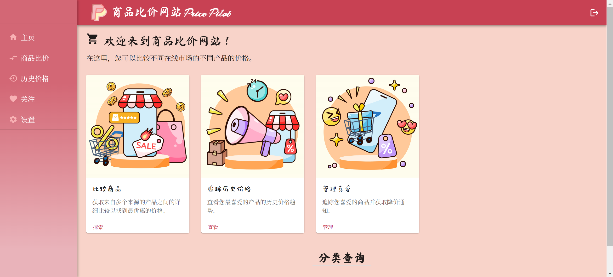
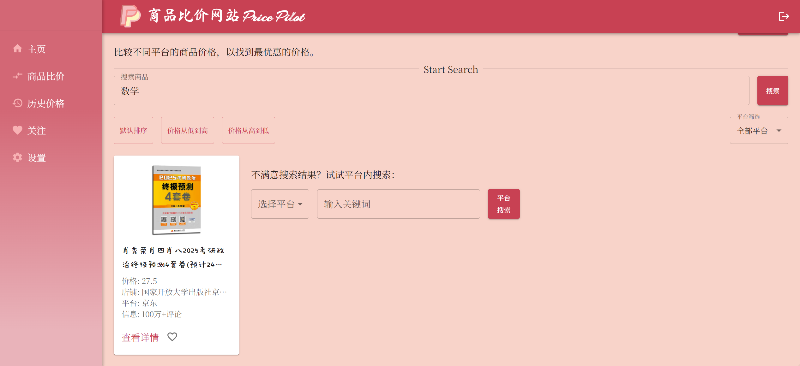
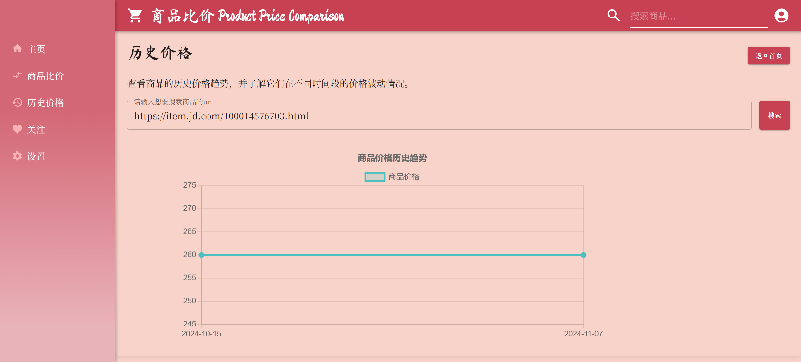
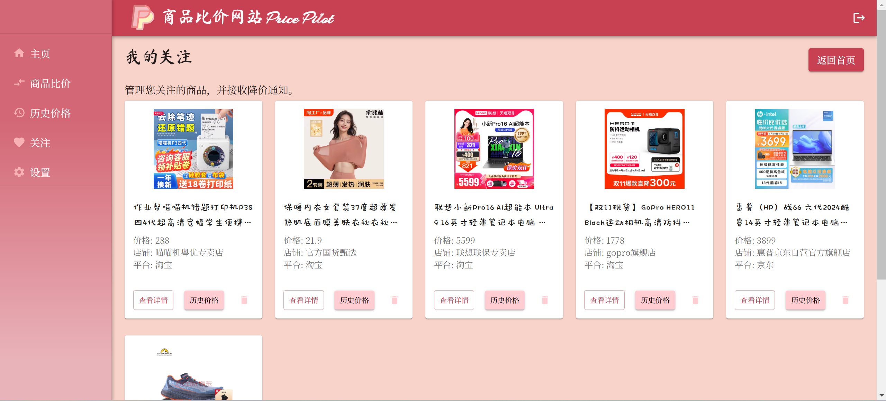

# Price Pilot

[English](#english) · [简体中文](#中文)

## English

### Overview

Price Pilot is a web app for comparing product prices on Taobao and JD.com. Search the local catalog by keyword or browse by category, then filter listings by marketplace or sort them by price. You can view recorded price trends, save products to your favorites, and receive email alerts when their prices drop.

The app was built as a browser/server software design course project. It uses React and Material UI for the interface, Chart.js for price charts, and Django with MySQL for the backend.

### Screenshots

These screenshots come from the project reports. See the [user guide](./report/用户使用手册.md) for more screens.

#### Home



#### Product comparison



#### Price history



#### Favorites



### Runtime limitations

- **Docker and crawling** — The current Compose configuration cannot run browser-based tasks. These include live marketplace searches on Taobao and JD.com, refreshing a price and viewing its history from a product URL, and batch price updates for favorites. Once the database is ready, you can search the local catalog and view recorded price history from the Favorites page.
- **Local crawling** — You need Chrome or Chromium and must manually sign in to the marketplace first. Rerun the corresponding `login_crawler` command when the session expires. To refresh a price by URL, the product must already exist in the local database.
- **Initial catalog data** — Local migrations create the tables. To populate the catalog, import compatible data or collect listings through live marketplace search on a local installation. The legacy `data/backend_products.sql` file lacks the `link_hash` field required by the current model. The full `bs.sql` backup referenced by Compose is absent from the repository.
- **Email and price updates** — Sign-up verification, password reset by email, and price-drop alerts require Gmail SMTP credentials. An administrator must run or schedule the commands that update favorite prices and send alerts. A catalog-wide price refresh is currently unavailable.

### Repository layout

- `app/` contains the React frontend.
- `backend/` and `djangoProject/` contain the Django backend and settings.
- `data/` contains sample product data and legacy SQL files.
- `catch/` contains data collection scripts.
- `report/` contains the [design report](./report/设计报告.md), [user guide](./report/用户使用手册.md), and [test report](./report/测试报告.md) in Chinese.

### Run locally

Install Python 3.10, Node.js with npm, and MySQL 8.0.

1. From the repository root, create a Python virtual environment and install dependencies.

   ```bash
   python3.10 -m venv .venv
   source .venv/bin/activate
   pip install -r requirements.txt
   cp .env.example .env
   ```

2. Use `.env.example` as a guide to set `DJANGO_SECRET_KEY`, the database connection, and the email credentials. Gmail SMTP requires an app password. Git ignores `.env`.
3. Start MySQL, create the database named by `DB_NAME` (default `bs`), and initialize the schema. If you have a full backup compatible with the current models, you can import it into the new database with a command such as `mysql -u root -p bs < bs.sql`.

   ```bash
   python manage.py makemigrations backend
   python manage.py migrate
   ```

4. Start the backend from the repository root.

   ```bash
   python manage.py runserver
   ```

5. In a second terminal, start the frontend from the repository root and open [http://localhost:3000](http://localhost:3000).

   ```bash
   cd app
   npm install
   npm start
   ```

The React development server proxies `/backend` requests to `http://localhost:8000`. Django sessions maintain the login state.

### Docker deployment

Place `.env` and a `bs.sql` backup compatible with the current models in the repository root. The bundled MySQL service uses `root` and `DB_PASSWORD` and imports the SQL when it first initializes the database volume. Once the services are running, open [http://localhost:3000](http://localhost:3000).

```bash
docker compose up --build
```

### Management commands

Run these commands from the repository root. Before using the crawler, run the login command for the relevant marketplace, sign in through the browser window, and press Enter in the terminal.

```bash
python manage.py login_crawler taobao
python manage.py login_crawler jd
```

Update the prices of products in users' favorites, then send price-drop alerts to users who have enabled them.

```bash
python manage.py update_favorite_prices
python manage.py send_emails
```

The legacy maintenance command `python manage.py update_link_hash` backfills link hashes for old product records.

---

## 中文

### 项目介绍

Price Pilot 是一个面向淘宝和京东的商品比价网站。你可以按关键词搜索或按分类浏览本地商品库，按电商平台筛选商品，或按价格排序。网站支持查看历史价格走势、关注商品，并在商品降价时接收邮件提醒。

本项目是《B/S 体系软件设计》课程项目。前端使用 React 和 Material UI，价格图表使用 Chart.js，后端使用 Django 和 MySQL。

### 页面截图

以下截图来自项目报告，更多页面见[用户使用手册](./report/用户使用手册.md)。

#### 首页


#### 商品比价


#### 历史价格


#### 关注列表


### 运行限制

- **Docker 与爬虫**：当前 Compose 配置无法运行依赖浏览器的爬虫功能，包括淘宝和京东的站内搜索、按商品链接刷新价格并查询历史，以及关注商品的批量价格更新。数据库搜索和关注页读取已存的历史价格可在数据库就绪后使用。
- **本地爬虫**：需要可用的 Chrome 或 Chromium，并先手动登录要使用的电商平台。登录失效后，重新运行对应的 `login_crawler` 命令。按链接刷新历史价格时，该商品必须已存在于本地数据库。
- **数据库初始数据**：本地迁移只创建表，商品搜索需要先导入与当前模型兼容的数据，或通过本地平台搜索采集。`data/backend_products.sql` 是旧版数据，缺少当前模型要求的 `link_hash` 字段。Compose 引用的完整数据库备份 `bs.sql` 未随仓库提供。
- **邮件与价格更新**：注册验证、邮箱找回密码和降价提醒依赖 Gmail SMTP 配置。项目提供关注商品的价格更新与邮件发送命令，需要管理员手动运行或自行调度。全量商品价格刷新尚未实现。

### 项目结构

- `app/` 存放 React 前端。
- `backend/` 和 `djangoProject/` 存放 Django 后端及配置。
- `data/` 存放商品样例数据和历史 SQL 文件。
- `catch/` 存放数据采集脚本。
- `report/` 存放[设计报告](./report/设计报告.md)、[用户使用手册](./report/用户使用手册.md)和[测试报告](./report/测试报告.md)。

### 本地运行

准备 Python 3.10、Node.js 与 npm，以及 MySQL 8.0。

1. 在项目根目录创建 Python 虚拟环境并安装依赖。

   ```bash
   python3.10 -m venv .venv
   source .venv/bin/activate
   pip install -r requirements.txt
   cp .env.example .env
   ```

2. 按照 `.env.example` 配置 `DJANGO_SECRET_KEY`、数据库连接和邮件服务。Gmail SMTP 需要应用专用密码。`.env` 已被 Git 忽略。
3. 启动 MySQL，创建与 `DB_NAME` 一致的数据库（默认 `bs`），再初始化表结构。如果已有与当前模型兼容的完整备份，可改为导入备份，例如 `mysql -u root -p bs < bs.sql`。

   ```bash
   python manage.py makemigrations backend
   python manage.py migrate
   ```

4. 在项目根目录启动后端。

   ```bash
   python manage.py runserver
   ```

5. 在另一个终端从项目根目录启动前端，然后访问 [http://localhost:3000](http://localhost:3000)。

   ```bash
   cd app
   npm install
   npm start
   ```

React 开发服务器将 `/backend` 请求代理到 `http://localhost:8000`，登录状态由 Django Session 维护。

### Docker 部署

在项目根目录准备好 `.env` 和与当前模型兼容的 `bs.sql`。自带的 MySQL 服务使用 `root` 和 `DB_PASSWORD`，并在首次初始化数据库卷时导入 SQL。启动后访问 [http://localhost:3000](http://localhost:3000)。

```bash
docker compose up --build
```

### 管理命令

在项目根目录运行以下命令。使用爬虫前，运行对应平台的登录命令，在打开的浏览器中完成登录，然后回到终端按回车。

```bash
python manage.py login_crawler taobao
python manage.py login_crawler jd
```

先更新用户关注的商品价格，再向已开启提醒的用户发送降价邮件。

```bash
python manage.py update_favorite_prices
python manage.py send_emails
```

旧数据维护命令 `python manage.py update_link_hash` 用于给旧商品记录回填链接哈希。
