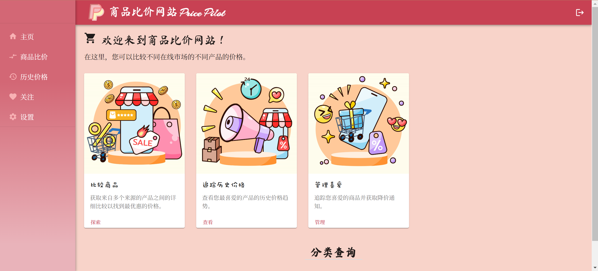
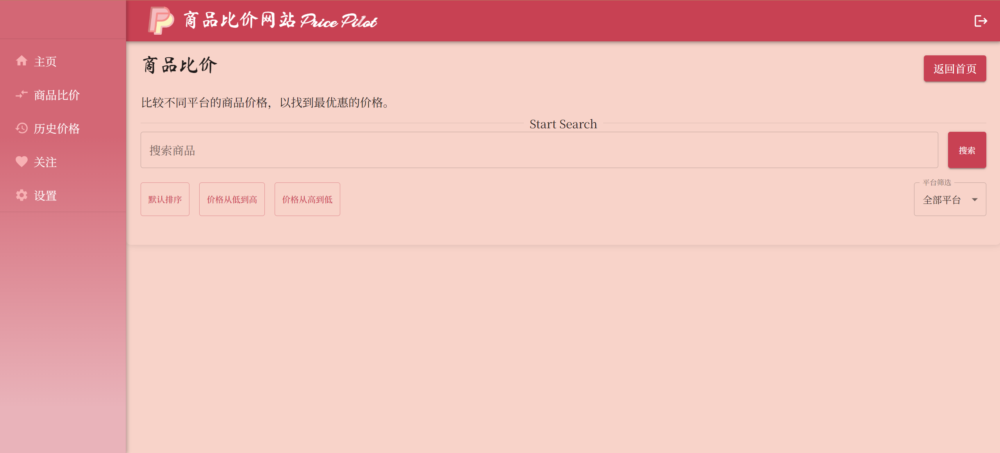
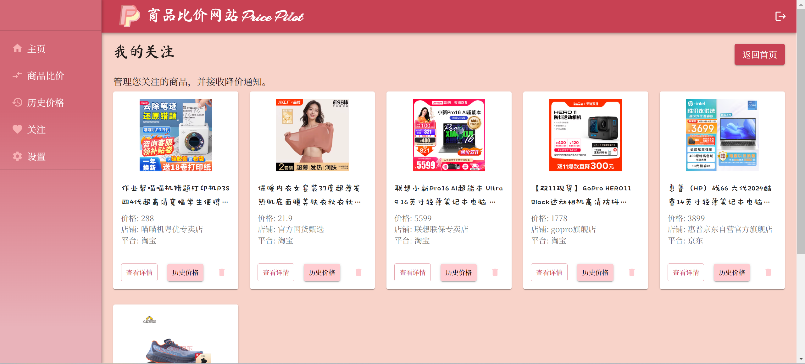
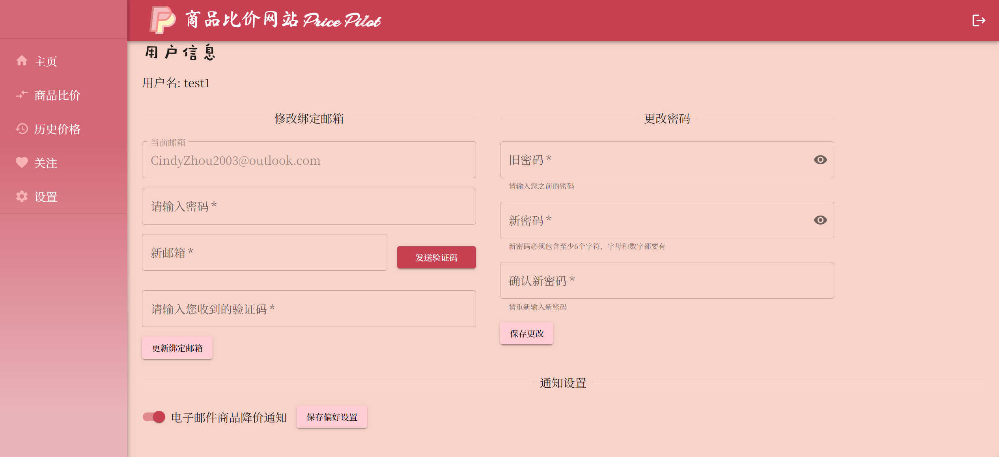

<div align=center STYLE="page-break-after: always;">
<br/><br/><br/><br/><br/><br/><br/>

<br/><br/><br/><br/><br/>
    <font size=5 face="宋体" style="bold">
        本科实验报告
    </font>
<br/><br/><br/><br/><br/><br/>
<font size=5 face="楷体">
课程名称： B/S 体系软件设计      <br/>      
姓  名：   周歆仪           <br/>    
学  院：   计算机科学与技术学院 <br/>
系：       计算机科学与技术系   <br/>
专  业：   软件工程            <br/> 
学  号：   3220106418          <br/> 
指导教师： 胡晓军            <br/>     
</font>
<br/>
<font size = 5>
<br/>
<br/>
2024 年 11 月 10 日
<br/><br/>
</font>
</div>

<div align=center>
    <font size=4 style="bold">
        浙江大学实验报告
    </font>
</div>


课程名称：B/S 体系软件设计 

实验类型：综合型		实验项目名称：商品比价网站开发

学生姓名：周歆仪		专业：软件工程		学号：3220106418

指导老师：胡晓军		实验地点：玉泉 8 舍	实验日期：2024 年 11 月 10 日


# 商品比价网站-设计报告

**目录**

[toc]


## 项目简介

### 背景

本项目是 2023-2024 秋冬学期《B/S 体系软件设计》的课程项目——商品比价网站开发。随着电子商务的迅猛发展，越来越多的用户选择在线购买商品。然而，不同电商平台之间的商品价格存在差异，消费者往往需要花费大量时间在各个平台之间进行价格比较，才能找到最优惠的购买选择。因此，通过本项目的开发，我们希望能够为用户提供更好的购物体验，并通过技术手段提高用户在电商平台上的购买决策效率。

### 项目目标

该项目的目标是为用户提供一个简便易用的在线商品比价工具，帮助用户在多个电商平台之间快速查询商品价格，并进行价格比较。用户可以通过输入商品名称获取实时价格信息，查看商品的历史价格走势，设置降价提醒，从而实现更明智的购物决策。

### 核心功能

1. **用户注册与登录**：用户可以通过网站进行注册和登录，并保存个性化的设置，如关注的商品和降价提醒等。
2. **商品查询与比价**：用户可以输入商品名称，系统会自动从支持的多个电商平台抓取商品的实时价格，并展示比价结果。
3. **历史价格查询**：系统将定期记录各平台的商品价格变化，用户可以通过图表形式查看商品的历史价格趋势。
4. **降价提醒**：用户可以为特定商品设置降价提醒，当商品价格低于用户设定的阈值时，系统会通过邮件或 APP 推送的方式通知用户。
5. **移动适配与 App 支持**：网站支持移动设备的浏览器访问，同时为后续移动应用的开发提供支持，使用户可以随时随地查询商品价格。

### 面向用户群体

1. **价格敏感型消费者**：希望在购买商品时找到最低价格的用户。
2. **重视性价比的用户**：希望比较不同电商平台的价格、评价等信息，以便做出最佳购买决策的用户。
3. **在线购物频繁的消费者**：习惯于通过各大电商平台进行购物，并希望减少在价格查询上花费时间的用户。

### 项目价值

1. **为用户节省购物时间**：用户可以在一个平台上对比多个电商平台的商品价格，不必切换多个网站进行手动查询。
2. **提供价格趋势分析**：通过历史价格查询功能，帮助用户了解商品价格的波动趋势，从而选择更合适的购买时机。
3. **增强购物体验**：通过降价提醒功能，用户可以在商品价格降低时第一时间得到通知，从而抓住优惠机会。

### 项目范围

本项目涵盖以下几个部分的开发：

- **前端部分**：
  - 使用 **React.js** 来构建动态、交互性强的用户界面。React.js 的组件化结构将帮助开发人员高效地创建可维护、可扩展的用户界面。
  - **Material-UI** 被用于快速构建响应式的 UI 界面，确保良好的用户体验，支持桌面端和移动端访问。
  - **Chart.js** 用于在前端展示商品的历史价格图表，支持动态交互和图表展示。

- **后端部分**：
  - **Python + Django**：后端使用 Django 框架来处理核心业务逻辑，如商品信息管理、价格查询与比价、用户注册与登录等功能。Django 提供了强大的 ORM 功能，支持快速开发和数据库管理。
  - **RESTful API**：后端使用 Django REST framework（DRF）构建 RESTful API，前端通过 API 请求获取商品数据、价格历史以及其他必要信息。
  - 用户管理、商品信息管理、降价提醒设置和价格数据的定期更新等均通过 Django 后端进行处理。

- **爬虫及数据抓取**：
  - 使用 **DrissionPage** 和 **Selenium** 来抓取电商平台（如淘宝、京东等）的商品数据。  
    - **DrissionPage**：作为一个高效的爬虫工具，它简化了抓取和解析网页内容的过程，能够处理页面交互和动态加载数据。它能与现代网页的 JavaScript 渲染机制兼容，尤其适用于抓取商品的实时价格数据。
    - **Selenium**：用于处理一些需要复杂用户交互（如登录、滚动加载等）或动态页面内容抓取的电商平台。通过自动化浏览器，Selenium 能模拟用户操作并抓取页面中呈现的所有信息。

- **数据库部分**：
  - 采用 **MySQL** 数据库进行数据存储，所有商品信息、价格历史记录、用户信息及降价提醒设置都存储在数据库中。
  - **MySQL** 提供高效的查询性能，适合高并发访问和数据一致性要求。
  - 数据库设计包括商品库（包括商品名称、品类、规格、价格等信息）、用户数据、历史价格数据、以及降价提醒设置等。

- **容器化部署**：
  - 使用 **Docker** 对整个项目进行容器化，以确保开发环境和生产环境的一致性。通过容器化部署，能够快速搭建环境并解决环境依赖问题。
  - **Docker Compose** 用于管理多个容器的协调与编排，确保前端、后端、数据库、爬虫服务等能够高效地交互和运行。
  - 项目的容器化部署将使得在开发和生产环境中都能保持一致的运行状态，简化应用的部署与扩展。

## 系统需求分析

### 功能性需求

#### 用户注册与登录

用户可以通过电子邮件进行注册，并使用用户名和密码进行登录。具体要求如下：

- 用户名和电子邮件在系统中必须唯一。
- 用户密码需满足安全要求：密码长度必须大于等于 6 位，并且包含至少一个字母和一个数字。
- 注册时必须验证电子邮件格式，确保输入的电子邮件地址符合标准格式（例如：<user@example.com>）。
- 登录时，系统会检查用户名和密码是否匹配，且需提供“忘记密码”的功能，支持用户通过电子邮件找回密码。
- 系统需确保用户数据的安全性，采用哈希加密存储密码。

#### 商品查询与比价

用户登录后，可以通过商品名称查询在多个主流电商平台（如淘宝、京东等）上的实时价格。具体要求如下：

- 商品名称输入框支持自动补全和关键词分词，以提高搜索准确性。
- 系统通过调用各大电商平台的开放 API 或爬虫技术获取商品的实时价格信息。
- 查询结果应包含商品的名称、价格、平台名称、商品链接等信息。
- 若同一商品在多个平台上存在价格，系统应以表格或卡片形式展示不同平台的价格，支持按价格排序。
- 用户可以点击查看商品的详细信息，并访问该商品在电商平台的购买链接。

#### 商品信息管理

为了便于管理和展示商品信息，系统需要维护一个商品信息库。功能要求如下：

- **商品增删改查**：管理员可以通过后台管理系统添加、删除或修改商品信息，包括商品名称、品类、规格、条码、图片等。
- **图片上传**：商品图片可以通过后台管理界面上传，支持常见图片格式（如 .jpg, .png）。
- **商品分类管理**：支持商品多级分类，便于管理和查询。
- **商品状态**：可以标记商品的当前状态，如“在售”、“下架”或“停售”。

#### 历史价格展示

系统会定期抓取并存储商品的历史价格信息。用户可以查看某个商品在不同时间点的价格走势。具体要求如下：

- 商品的历史价格以图表形式展示，用户可以查看价格的变化趋势。
- 支持选择查看某一段时间内的价格走势（如过去 7 天、30 天、90 天等）。
- 图表展示应包括价格的最高点、最低点和当前价格。
- 提供动态图表展示，用户可以鼠标悬停查看某一时间点的价格数据。

#### 降价提醒

用户可以为特定商品设置降价提醒，系统会在商品价格降低时通过邮件或 App 推送等方式提醒用户。具体要求如下：

- 用户可以在商品页面点击“设置降价提醒”按钮，输入希望接收提醒的价格阈值。
- 系统定时查询商品价格并与用户设置的阈值进行对比，一旦价格降至阈值以下，系统自动发送通知。
- 支持通过电子邮件或推送通知方式提醒用户商品的降价信息。
- 提供用户查看已设置提醒的界面，用户可以编辑或删除降价提醒设置。

#### 爬虫数据抓取

系统将从多个电商平台（淘宝、京东）抓取商品的实时价格和信息，具体功能包括： 

- **自动化抓取**：通过爬虫模块（如 DrissionPage、Selenium），定时/用户有搜索需求时抓取各大电商平台上的商品数据。 
- **数据清洗与存储**：对抓取到的数据进行清洗、去重，并将结果存储到 MySQL 数据库中。 
- **应对平台反爬**：爬虫模块将采用一定的反爬机制，如模拟登录，以确保数据抓取的稳定性。

### 用例图


### 性能需求

- **响应时间**：商品查询和比价功能的响应时间应不超过 3 秒，以确保良好的用户体验。
- **系统负载**：系统应支持并发用户访问，能处理高并发的商品查询请求。
- **数据抓取频率**：系统需要定时抓取电商平台的数据，确保商品价格信息的时效性，每隔一段时间抓取一次主要商品数据。
- **高可用性**：系统应具备高可用性，支持故障转移和负载均衡。该系统应实现多 Web 浏览器支持：在大多数流行的 Web 浏览器中正确显示和执行，包括 Firefox、Chrome、Edge 等。

### 输入输出需求

- **输入需求**：用户输入商品名称进行搜索，系统根据该名称进行查询并返回商品的实时价格和历史价格数据。
- **输出需求**：系统返回商品比价结果，显示各电商平台的实时价格、历史价格图表、商品详情及链接。系统还会在降价时向用户发送通知。

### 数据管理需求

- **数据存储**：所有商品信息、用户信息、价格历史和降价提醒设置等数据需保存在数据库中。使用 MySQL 进行数据持久化存储，保证数据的安全性和一致性。
- **数据备份**：定期对数据库进行备份，防止数据丢失。
- **数据更新**：系统需要定期抓取电商平台的商品信息，更新数据库中的价格数据，确保信息的时效性。

### 安全性需求

1. 保密性
  （1）用于身份验证的用户名和密码应该防止未经授权的用户访问系统，防止没有授权的用户进行管理员的相关操作。
  （2）建立合理的访问控制来防止有权限的管理员跨权限使用系统的资源。敏感数据交换之前要进行加密，密码存储之前应该加密。
  （3）在用户登录期间要防止 SQL 注入和密码强制破解和伪造会话入侵。

2. 完整性
  防止非法用户对数据进行无意或恶意的修改、插入、删除，防止数据丢失。

3. 约束性
  （1）为数据库加上一定的约束，对关键性操作如删除、修改进行限制，并对用户进行警示。
  （2）不同身份所拥有的权限不同，只可以进行自己权限内的操作。

4. 用户信息安全性
  （1）着重账户信息安全性设计，做到外界人员无法入侵到系统本身。

  （2）内部人员操作需要留下操作痕迹，使用权管理层可以定期或不定期地维护系统。

5. 访问控制
   系统应该实现访问控制机制，以确保只有授权用户可以访问系统资源。这可以通过使用身份验证和授权机制来实现，例如使用用户名和密码进行身份验证，并使用访问令牌或角色来授权用户访问特定资源。
6. 数据加密
   系统应该使用加密技术来保护敏感数据的机密性和完整性。例如，在传输过程中，可以使用 SSL / TLS 协议来加密数据，以防止未经授权的用户访问数据。在存储过程中，可以使用加密算法对密码等敏感数据进行加密，以防止数据泄露。
7. 防止攻击
   系统应该实现安全措施来防止各种攻击，例如 SQL 注入、密码强制破解和会话劫持等。这可以通过使用安全编码实践、使用防火墙和入侵检测系统等技术来实现。
8. 安全审计
   系统应该记录所有用户的操作，以便在发生安全事件时进行调查和审计。这可以通过使用日志记录和审计工具来实现，以便管理员可以检查系统中发生的所有事件，并确定是否存在安全问题。

### 可维护性需求

作为一个成熟的系统，在开发初期就应该充分考虑系统的可维护性。对此，本项目提出以下几点要求：

1. 高内聚、低耦合的系统模块划分。开发者需要充分考虑模块内部结构的紧密型及模块间联系的独立性。
2. 完备、清晰、可读的文档。文档是影响软件可维护性的一个决定因素，一个好的文档应具有简明性和书写风 格的一致性，从而提高系统的可读性和可修改性。设计系统时应准备好各类相关文档，方便操作人员的对功能的快速查阅及维护人员的对架构的系统掌握。交付时应文档齐全，说明详尽，且文档描述符合相关标准。
3. 良好的编程风格：程序内部应有详细的注释和统一的编程格式，结构清晰、注释明确，使试、测试人员能快速定位各种错误。对编程风格的具体要求如下：不使用令人捉摸不定或含糊不清的代码；使用有意义的数据名和过程名；适当的、格式正确的注释；使用模块化、结构化的设计方法；具有正确、一致和完整的文档。
4. 严谨的单元测试：对核心模块应编写单元测试，在交互时保证各子模块和系统整体的正常运作。对可测试性的要求如下：具有模块化和良好的结构；具有可理解性、可靠性；能显示任意的中间结果；以清楚的描述方式说明系统的输出，根据要求显示所有的输入。
5. 可扩展性：系统应该具备可扩展性，以便在未来需要添加新功能或模块时，可以轻松地进行扩展。这可以通过使用模块化和面向对象的设计方法来实现，以便可以轻松地添加新的类和方法。
6. 易于维护的代码：系统应该编写易于维护的代码，以便在未来需要进行修改或更新时，可以轻松地进行维护。这可以通过使用清晰、简洁、可读性强的代码编写规范来实现，以便开发人员可以轻松地理解和修改代码。
7. 自动化测试：系统应该具备自动化测试能力，以便在进行修改或更新时，可以自动化地进行测试，以确保系统的稳定性和正确性。这可以通过使用自动化测试工具和测试框架来实现，以便可以轻松地进行测试和验证。
8. 版本控制：系统应该使用版本控制工具来管理代码和文档，以便可以轻松地跟踪和管理系统的版本和变更历史。这可以通过使用 Git、SVN 等版本控制工具来实现，以便可以轻松地进行版本控制和协作开发。

## 系统技术与系统架构

### 项目技术选型

- **前端技术**：
  - **React.js**：适用于构建动态交互的用户界面，能够实现单页面应用（SPA），提高前端开发效率。
  - **Material-UI**：一个基于 React 的 UI 组件库，提供丰富的 UI 组件，能够加快界面开发速度。
  - **Chart.js**：一个轻量级的开源图表库，用于展示商品的历史价格走势。

- **后端技术**：
  - **Node.js + Express**：Node.js 提供高效的非阻塞 I/O，适合处理并发请求；Express 是一个轻量级的 Web 框架，便于快速开发 RESTful API。
  - **Python + Django**：Django 提供快速开发的全栈功能，适合开发与爬虫相关的后台服务，Python 具有丰富的数据处理和爬虫库，能够快速抓取商品数据。

- **数据库**：
  - **MySQL**：关系型数据库，适用于存储商品信息、用户信息和价格历史数据。MySQL 支持高并发查询和事务管理，能够保证数据的完整性和一致性。

- **爬虫与 API 抓取**：
  - **DrissionPage 和 Selenium**：用于抓取电商平台的商品信息。DrissionPage 提供了简便的方式来与网页交互，Selenium 是一个强大的 Web 自动化工具，能够处理复杂的动态网页和 JavaScript 渲染。

- **容器化与部署**：
  - **Docker + Docker Compose**：使用 Docker 容器化部署系统，保证开发和生产环境一致性。Docker Compose 用于管理多个容器的部署和编排。
  - **Nginx**：用作反向代理服务器，分发请求到不同的服务，提供负载均衡和高可用性。

### 项目主要技术介绍

#### 前端技术

- **React.js**：React 是一个流行的 JavaScript 库，用于构建用户界面，特别适合构建动态和交互式的单页应用。React 的组件化结构使得开发过程更加模块化和高效。
  
- **Material-UI**：Material-UI 是一个实现 Material Design 风格的 React UI 组件库，提供了丰富的可自定义组件，能够快速构建现代化的 Web 界面。

- **Chart.js**：Chart.js 是一个轻量级的图表库，可以轻松生成交互式的图表，展示商品的价格趋势。它支持各种图表类型，包括折线图、柱状图、饼图等。

- **npm 包管理工具**：**npm**（Node Package Manager）是 JavaScript 环境中的包管理工具，用于安装和管理项目所需的库和依赖项。npm 通过 `package.json` 文件记录和管理项目依赖，使得项目的安装和构建更加高效和一致。此外，npm 还支持版本控制和依赖项锁定，以确保不同环境中使用的库版本一致，减少了开发过程中的兼容性问题。

#### 后端技术

- **Python + Django**：Python 提供丰富的爬虫和数据处理库，Django 是一个成熟的全栈 Web 框架，提供高效的 ORM、路由和表单处理能力。后端负责爬虫抓取、商品比价逻辑、用户管理等功能。

#### 接口设计

本项目采用 **axios** 库进行前后端交互。

- axios 是一个基于 Promise 的 HTTP 客户端，用于在前端与后端服务器之间发送请求和接收响应。相比于原生的 `fetch` API，axios 提供了更友好的 API 接口，支持自动序列化 JSON 数据、自动处理错误、设置请求和响应拦截器等功能。

在本项目中，axios 被用于：

- **发送 GET 请求**：从后端获取商品信息、价格数据、历史价格记录等。
- **发送 POST 请求**：用于用户登录、注册等操作，携带用户输入的数据。
- **拦截请求和响应**：可以在请求发出之前或响应接收之后进行数据处理（如统一处理错误，管理授权 token），增强代码的可维护性和扩展性。

#### 数据库

- **MySQL**：用于存储用户数据、商品信息、价格历史等。MySQL 提供高性能的查询能力，适合用作关系型数据存储。

#### 爬虫与 API 抓取

- **DrissionPage 和 Selenium**：DrissionPage 是一个高效的网页爬虫工具，简化了网页抓取的操作，Selenium 是一个强大的自动化测试工具，也常用于抓取动态网页内容。

#### 容器化与部署

- **Docker**：通过 Docker 容器化项目，确保项目在不同环境中的一致性。Docker Compose 用于管理多容器应用，确保服务的协调与管理。

### 系统架构设计

#### 系统总体架构图

```scss
            +-------------------------------+
            |      用户浏览器 (Web Browser)  |
            +-------------------------------+
                            |
                            v
            +-------------------------------------+
            |      前端 (React.js)                |
            |  - 用户界面 (UI)                     |
            |  - 页面路由 (SPA)                    |
            |  - 数据请求 (Axios)                  |
            +-------------------------------------+
                            |
                            v
            +----------------------------------------+
            |       API 层 (Django REST Framework)   |
            |  - 处理前端请求                          |
            |  - JSON 数据接口                        |
            +----------------------------------------+
                            |
                            v
            +------------------------------------+
            |      后端 (Django)                  |
            |  - 业务逻辑处理                      |
            |  - 用户认证与授权                    |
            |  - 数据处理与存储                    |
            +------------------------------------+
                            |
                            v
            +------------------------------------+
            |       数据库 (MySQL)                |
            |  - 用户信息                         |
            |  - 商品信息                         |
            |  - 历史价格数据                      |
            |  - 降价提醒设置                      |
            +------------------------------------+
                            |
                            v
            +-----------------------------------+
            |   爬虫服务 (DrissionPage/Selenium)  |
            |       - 数据抓取与更新               |
            +-----------------------------------+
```

#### 前端架构图

```scss
                      +-------------------+ 
                      |    React (SPA)    |  
                      +-------------------+ 
                                  |
                                  v
                +-------------------------------+
                |          页面组件              |
                | - 注册/登录页面                |
                | - 商品查询页面                 |
                | - 历史价格图表                 |
                | - 用户设置界面（ 降价提醒）      |
                +-------------------------------+
                                  |
                                  v
                +-------------------------------+
                |       状态管理 (Context API)   |
                | - 全局用户状态 (Auth)          |
                | - 商品数据管理 (Product Store) |
                | - 提醒设置 (Alerts Store)      |
                +-------------------------------+
                                  |
                                  v
                +-------------------------------+
                |           API 服务            |
                |  - Axios 请求封装              |
                |  - 与 Django 后端交互          |
                |  - 错误处理和重试机制           |
                +-------------------------------+
                                  |
                                  v
                +-------------------------------+
                |         数据可视化组件         |
                |    - Chart.js (价格走势图)    |
                |    - 动态图表交互             |
                |    - 历史价格数据展示          |
                +-------------------------------+
                                  |
                                  v
                +-------------------------------+
                |           UI 组件库            |
                |      - Material-UI            |
                |      - 自定义样式和主题         |
                |      - 表格、按钮、对话框等      |
                +-------------------------------+
                                  |
                                  v
                +-------------------------------+
                |       前端路由 (React Router) |
                |  - 页面导航                   |
                |  - 私有路由保护               |
                |  - 动态路由加载               |
                +-------------------------------+
                                  |
                                  v
                +-------------------------------+
                |        本地存储 (LocalStorage) |
                |  - 用户登录 Token              |
                |  - 用户偏好设置                 |
                |  - 商品查询历史                 |
                +-------------------------------+

```

#### 后端架构图

```scss
                +----------------------------+
                |       Django 框架          |
                +----------------------------+
                               |
                               v
          +--------------------------------------+
          |        应用层 (App Layer)            |
          | - 用户认证与授权 (Authentication)     |
          | - 商品管理与比价 (Product Management) |
          | - 降价提醒处理 (Price Alerts)        |
          | - 异常处理和日志记录 (Error Logging) |
          +--------------------------------------+
                               |
                               v
          +--------------------------------------+
          |        服务层 (Service Layer)         |
          | - 业务逻辑处理                        |
          | - 数据验证 (Data Validation)          |
          | - 调用爬虫模块 (Scraper Service)      |
          | - 调用通知模块 (Email & Notifications)|
          +--------------------------------------+
                               |
                               v
          +--------------------------------------+
          |       数据库访问层 (Django ORM)       |
          | - 数据库操作 (CRUD)                   |
          | - 连接 MySQL 数据库                   |
          | - 执行事务管理 (Transaction)          |
          +--------------------------------------+
                               |
                               v
          +--------------------------------------+
          |    RESTful API 层 (Django REST API)  |
          | - 提供 JSON 数据接口                 |
          | - 用户注册、登录、商品查询 API        |
          | - 商品比价与降价提醒 API             |
          | - 前端请求验证 (Request Validation)   |
          +--------------------------------------+
                               |
                               v
          +--------------------------------------+
          |      爬虫模块 (DrissionPage, Selenium)|
          | - 定时任务 (Cron Jobs)               |
          | - 商品数据抓取                       |
          | - 登录电商平台进行数据提取            |
          | - 数据清洗与格式化                   |
          +--------------------------------------+
                               |
                               v
          +--------------------------------------+
          |   通知模块 (Notification Module)     |
          | - 发送邮件 (SMTP)                   |
          | - 推送通知 (Push Notifications)     |
          | - 降价提醒处理                      |
          +--------------------------------------+

```

### 系统运行环境

系统运行环境包括硬件环境和软件环境。

| 硬件             |                             | 软件     |                                                              |
| ---------------- | --------------------------- | -------- | ------------------------------------------------------------ |
| 操作系统         | Windows7 及以上、Linux、MAC | 操作系统 | CPU: CORE i5 及以上<br />内存：2G 及以上 <br />硬盘：500G 及以上 |
| 数据库服务器类型 | MySQL 8.0                   | 通讯设备 | 具有良好的数据传输能力                                       |
| 浏览器           | Chrome/Edge/Firefox         |          |                                                              |

## 数据库设计

### 数据库选型

本项目选择使用 **MySQL** 作为主要的关系型数据库，原因如下：

1. **数据一致性**：MySQL 是关系型数据库，支持事务和数据完整性检查，非常适合项目中涉及到的用户信息、商品信息、价格历史等数据的管理。
2. **查询性能**：MySQL 支持高效的查询性能，特别是在高并发查询场景下能够保证系统的快速响应，满足项目需求。
3. **丰富的生态和广泛支持**：MySQL 拥有丰富的生态系统、插件和工具支持，同时具有广泛的社区支持，开发维护较为便利。
4. **易于扩展**：MySQL 支持多种引擎（如 InnoDB 和 MyISAM），并且在需要时可以轻松扩展和进行分片，适合项目后期的规模扩展。
5. **支持 ACID 属性**：MySQL 支持事务的 ACID（原子性、一致性、隔离性、持久性）属性，能够保证数据在多用户操作下的一致性。

综上所述，MySQL 能够满足本项目对数据存储的需求，并提供可靠的性能和扩展性。

### 数据表设计

以下是项目中的主要数据表结构设计，包括字段说明、数据类型、主键及相关约束：

#### 用户表 (`Account`)

| 字段名    | 数据类型       | 说明             | 约束         |
| --------- | -------------- | ---------------- | ------------ |
| id        | AutoField      | 用户唯一标识     | 主键         |
| username  | CharField(45)  | 用户名           | 唯一，必填   |
| email     | EmailField(45) | 用户邮箱         | 唯一，必填   |
| password  | CharField(128) | 加密后的用户密码 | 非空         |
| is_active | BooleanField   | 用户是否活跃     | 默认为 True  |
| is_admin  | BooleanField   | 用户是否为管理员 | 默认为 False |

- **描述**：用户表存储用户的基本信息，采用自定义用户管理器 `MyAccountManager`，提供创建普通用户和管理员用户的功能。
- **约束**：`username` 和 `email` 字段均设置为唯一值，用于防止重复用户。

#### 商品表 (`Products`)

| 字段名    | 数据类型       | 说明                 | 约束      |
| --------- | -------------- | -------------------- | --------- |
| id        | AutoField      | 商品唯一标识         | 主键      |
| title     | CharField(255) | 商品名称             | 非空      |
| price     | FloatField     | 商品当前价格         | 非空      |
| info      | CharField(50)  | 评价或购买人数       | 非空      |
| shop      | CharField(50)  | 店铺名称             | 非空      |
| img       | CharField(350) | 商品图片 URL         | 非空      |
| link      | CharField(300) | 商品购买链接         | 非空      |
| link_hash | CharField(64)  | 商品购买链接的哈希值 | 非空 唯一 |
| platform  | CharField(20)  | 电商平台             | 非空      |
| category  | ForeignKey     | 商品品类             | /         |

- **描述**：商品表用于存储电商平台上的商品基本信息，包括商品名称、价格、店铺、图片和购买链接等。

#### 商品分类表（`Categories`）

| 字段名 | 数据类型   | 说明             | 约束 |
| ------ | ---------- | ---------------- | ---- |
| id     | AutoField  | 商品类别唯一标识 | 主键 |
| name   | CharField  | 品类名称         | 非空 |
| parent | ForeignKey | 指向上一级品类   | /    |

- **描述**：商品分类表用于对商品按类别进行搜索

#### 商品历史价格表 (`Prices`)

| 字段名     | 数据类型      | 说明                 | 约束                |
| ---------- | ------------- | -------------------- | ------------------- |
| id         | AutoField     | 历史价格记录唯一标识 | 主键                |
| product_id | ForeignKey    | 商品 ID              | 外键关联 `Products` |
| price      | FloatField    | 商品历史价格         | 非空                |
| platform   | CharField(20) | 价格来源平台         | 非空                |
| is_valid   | BooleanField  | 价格记录是否有效     | 默认为 True         |
| created_at | DateTimeField | 价格记录创建时间     | 自动添加            |

- **描述**：商品历史价格表存储商品的历史价格信息，记录每次抓取的价格变化情况。
- **索引**：根据 `created_at` 字段降序排列，方便查询最新价格记录。

#### 用户关注表 (`Likes`)

| 字段名     | 数据类型   | 说明             | 约束                |
| ---------- | ---------- | ---------------- | ------------------- |
| id         | AutoField  | 关注记录唯一标识 | 主键                |
| user_id    | ForeignKey | 用户 ID          | 外键关联 `Account`  |
| product_id | ForeignKey | 商品 ID          | 外键关联 `Products` |

- **描述**：用户关注表记录用户对商品的关注，用于提供个性化推荐或提醒服务。
- **约束**：设置 `(user_id, product_id)` 组合唯一约束，确保每个用户对同一商品只能关注一次。

#### 数据表关系图

```scss
Account (用户表)
  |
  |--< Likes (用户关注表) >-- Products (商品表) —— Catogroies（商品类别表）
                                 |
                                 |--< Prices (商品历史价格表)
```

## 系统接口设计

### 用户信息相关接口

#### 用户登录

| **url**    | backend/login                                                |
| ---------- | ------------------------------------------------------------ |
| **参数值** | username: 用户名<br />password: 密码                         |
| **返回值** | (1)success: 登录成功；user: 用户信息<br/>(2)error: 登录失败；message: 错误消息，如用户名或密码错误 |
| **简介**   | 该接口用于用户登录，接受用户名和密码，验证用户身份。如果验证通过，返回成功标志和用户信息；否则返回失败标志和错误消息。 |

#### 用户注册

| **url**    | backend/register                                             |
| ---------- | ------------------------------------------------------------ |
| **参数值** | username: 用户名<br />email: 邮箱<br />password: 密码        |
| **返回值** | (1)success: 注册成功<br />(2)error: 注册失败；message: 错误消息，如用户名/邮箱已注册过，密码不符合要求 |
| **简介**   | 该接口用于用户注册，接受一组用户信息，包括用户名、密码、电子邮件。在注册前会检查用户名和邮箱的唯一性，以及密码长度和复杂度；如果通过验证，创建新用户并返回用户信息；否则返回错误消息。 |

#### 发送验证码

| **url**    | backend/send_verification_code                               |
| ---------- | ------------------------------------------------------------ |
| **参数值** | email: 邮箱                                                  |
| **返回值** | (1)success: 发送验证码成功 (2)error: 发送验证码失败；message: 错误消息 |
| **简介**   | 该接口用于给用户邮箱发送验证码以辅助注册、用户重置密码等操作 |

#### 验证验证码

| **url**    | backend/verify_code                                          |
| ---------- | ------------------------------------------------------------ |
| **参数值** | email: 邮箱<br />verification_code：验证码                   |
| **返回值** | (1)success: 验证码验证成功 (2)error: 验证码验证失败；message: 错误消息 |
| **简介**   | 该接口用于验证验证码的正误和邮箱是否匹配                     |

#### 修改密码

| **url**    | backend/change_password                                      |
| ---------- | ------------------------------------------------------------ |
| **参数值** | old_password: 旧密码<br />new_password: 新密码               |
| **返回值** | (1)success: 修改密码成功<br />(2)error: 修改密码失败；message: 错误消息，如旧密码错误 |
| **简介**   | 该接口用于用户修改用户密码，接受用户名以及新密码。在修改前会检查旧密码是否正确，如果通过验证，更新用户密码；否则返回错误消息 |

### 商品网站相关接口

#### 商品查询

| **url**    | backend/search_products                                      |
| ---------- | ------------------------------------------------------------ |
| **参数值** | search: 搜索关键词                                           |
| **返回值** | (1)success: 搜索商品成功<br />(2)error: 搜索失败；message: 错误消息，如没找到对应商品 |
| **简介**   | 该接口用于用户在数据库搜索对应的商品名称（经过分词优化）。如果搜索成功，则返回商品列表；否则返回错误消息或者没有找到对应商品 |

#### 更新单个商品价格并展示

| **url**    | backend/update_and_show_price                                |
| ---------- | ------------------------------------------------------------ |
| **参数值** | search: 商品的 url                                           |
| **返回值** | (1)success: 搜索并更新价格成功 price_list: 商品价格趋势 <br />(2)error: 搜索或更新失败；message: 错误消息，如更新价格失败 |
| **简介**   | 该接口用于用户根据数据库已有的某个商品链接，更新其价格并展示其价格趋势图。如果成功搜索并更新价格，返回商品价格以及对应的时间，生成价格趋势图；如果失败，则返回错误消息，如当前商品不在数据库内。 |

#### 降价提醒

| **url**    | backend/send_user_email                                      |
| ---------- | ------------------------------------------------------------ |
| **参数值** | product: 降价的商品                                          |
| **返回值** | (1)success: 发送邮件提醒降价成功<br />(2)error: 发送邮件提醒降价失败；message: 错误消息，如邮箱不存在 |
| **简介**   | 该接口用于网站管理者在发现用户关注列表商品降价时，向用户发送邮件提醒。如果发送邮件成功，则提示发送邮件提醒降价成功；否则，提示错误。 |

#### 关注商品

| **url**    | backend/like                                                 |
| ---------- | ------------------------------------------------------------ |
| **参数值** | id: 商品的 ID<br />user_id: 用户的 ID                        |
| **返回值** | (1)success: 关注商品成功<br />(2)error: 关注商品失败；message: 错误消息 |
| **简介**   | 该接口用于用户想关注一个商品，把它加入自己的关注列表中。如果关注成功，则提示关注成功；否则，提示错误。 |

#### 取消关注商品

| **url**    | backend/unlike                                               |
| ---------- | ------------------------------------------------------------ |
| **参数值** | id: 商品的 ID <br />user_id: 用户的 ID                       |
| **返回值** | (1)success: 取消关注商品成功 <br />(2)error: 取消关注商品失败；message: 错误消息 |
| **简介**   | 该接口用于用户想取消关注一个商品，把它从自己的关注列表中删除。如果取消关注成功，则提示取消关注成功；否则，提示错误。 |

#### 获取关注列表

| **url**    | backend/get_favorites                                        |
| ---------- | ------------------------------------------------------------ |
| **参数值** | user_id: 用户id                                              |
| **返回值** | (1)success:获取用户关注列表成功 product_list: 商品列表 (2)error: 获取用户关注列表失败；message: 错误消息 |
| **简介**   | 该接口用于获取用户关注列表。如果成功，则返回用户关注的商品列表；否则返回错误消息 |

#### 平台搜索（爬虫）商品加入数据库

| **url**    | backend/search_platform_products                             |
| ---------- | ------------------------------------------------------------ |
| **参数值** | search: 搜索关键词                                           |
| **返回值** | (1)success: 搜索成功 product_list: 商品列表<br />(2)error: 搜索失败；message: 错误消息，如用户未登录电商平台 |
| **简介**   | 该接口用于用户在电商平台搜索对应的商品名称，并将商品加入现有数据库并展示商品。如果搜索成功，则返回商品列表；否则返回错误消息，用户未登录电商平台等 |

#### 分类查询

| **url**    | backend/search_through_categories                            |
| ---------- | ------------------------------------------------------------ |
| **参数值** | category: 分类参数                                           |
| **返回值** | (1)success: 搜索成功 product_list: 商品列表 (2)error: 搜索失败；message: 错误消息 |
| **简介**   | 该接口用于用户根据对应商品类别搜索数据库中已有的商品。如果搜索成功，则返回商品列表；否则返回错误消息 |


| **url**    | backend/search_platform_products                             |
| ---------- | ------------------------------------------------------------ |
| **参数值** | search: 搜索关键词                                           |
| **返回值** | (1)success: 搜索成功 product_list: 商品列表 (2)error: 搜索失败；message: 错误消息，如用户未登录电商平台 |
| **简介**   | 该接口用于用户在电商平台搜索对应的商品名称，并将商品加入现有数据库并展示商品。如果搜索成功，则返回商品列表；否则返回错误消息，用户未登录电商平台等 |

## 系统界面

### 网站名称与图标


### 登录、注册界面

#### 登录


#### 注册


### 网站主页

#### 用户主页



#### 搜索界面



#### 关注商品界面



#### 搜索历史价格界面


#### 设置界面



## 安全性设计

### 用户数据保护

为了保护用户的隐私，本项目在处理用户数据时采取了以下措施：

1. **密码加密**：在用户注册或密码更新时，使用 Django 自带的 `django.contrib.auth.hashers` 模块对密码进行加密，调用 `make_password()` 函数对用户密码进行哈希处理。哈希算法会生成唯一的加密密码，即使数据库被泄露，原始密码也无法被轻易还原。
2. **数据最小化原则**：仅在用户登录验证等必要操作中使用用户密码数据，尽量避免在其他场景下保存敏感信息。
3. **敏感数据存储**：只在必要的情况下存储敏感信息，并对重要字段（如密码和支付信息）进行加密存储，防止泄露和非法访问。

### API 安全

在前后端开发中，本项目采取以下措施来防止常见的安全攻击：

1. **SQL 注入**：
   - **Django ORM**：Django ORM 自动构建 SQL 语句，避免直接拼接字符串生成查询语句，因此天然防止 SQL 注入攻击。
   - **参数化查询**：在任何需要直接写入 SQL 查询的情况中，使用参数化查询以确保查询参数的安全性。
   
2. **跨站请求伪造（CSRF）**：
   - Django 自带 CSRF 防护机制，在所有表单和 POST 请求中，自动生成和验证 CSRF token，确保请求来源的合法性。
   - 对所有涉及用户数据更新或操作的 API 接口启用 CSRF token 验证，防止跨站请求伪造。

3. **跨站脚本攻击（XSS）**：
   - **React**：React 默认会对所有动态数据进行自动转义，避免 XSS 攻击。
   - **Django**：在后端输出数据时，使用 Django 模板引擎的自动转义功能，确保动态数据不会被直接注入 HTML 中。同时，Django 提供了 `safe` 函数用于安全输出 HTML。
   - **内容安全策略（CSP）**：可以启用内容安全策略（CSP）头部，进一步限制前端页面加载的外部资源来源，防止恶意脚本加载。

### 数据加密与存储

为确保数据传输和存储的安全性，项目采用以下加密措施：

1. **传输加密**：通过 HTTPS 加密协议传输前后端和 API 数据，避免数据在传输过程中被窃听或篡改。
2. **数据库加密**：对数据库中的敏感信息（如用户密码、支付信息）进行加密存储，使用 Django 自带的 `make_password` 方法进行密码哈希。对于支付等高敏感数据，考虑使用外部安全存储或加密算法。
3. **加密算法**：优先采用安全性较高的加密算法（如 bcrypt），避免使用过时或弱加密算法。

## 项目进度与时间表

### 项目阶段划分

1. **需求分析与设计**：明确项目需求、制定系统架构、技术选型和数据库设计。
2. **前端开发**：使用 React.js 构建用户界面，包括注册、登录、商品查询、比价、降价提醒等页面。
3. **后端开发**：使用 Django 构建后端逻辑，包括用户管理、商品信息处理、历史价格跟踪和降价提醒等功能。
4. **爬虫开发**：使用 DrissionPage 和 Selenium 实现电商平台数据的实时抓取与更新。
5. **数据存储与管理**：设计并实现 MySQL 数据库表结构，处理用户、商品和历史价格数据存储。
6. **API 安全与数据保护**：完善系统安全设计，确保数据传输、存储及 API 访问的安全性。
7. **测试与优化**：进行功能测试、性能优化、安全性测试和修复。
8. **部署与上线**：使用 Docker 容器化项目，并部署至生产环境。
9. **后续维护与扩展**：持续监控系统状态，优化性能和功能。

### 时间表

| 阶段           | 时间      | 说明                               |
| -------------- | --------- | ---------------------------------- |
| 需求分析与设计 | 第 1-2 周 | 确定需求，进行架构设计和数据库设计 |
| 前端开发       | 第 3-4 周 | 使用 React.js 构建界面             |
| 后端开发       | 第 5-7 周 | Django 构建后端 API 和数据处理     |
| 爬虫开发       | 第 8-9 周 | 使用 DrissionPage 和 Selenium 爬虫 |
| 数据存储与管理 | 第 10 周  | 实现 MySQL 数据库表结构和管理      |
| 安全设计与测试 | 第 11 周  | 完善安全措施，进行测试             |
| 部署与上线     | 第 12 周  | Docker 容器化和上线                |
| 后续维护与扩展 | 持续进行  | 监控与优化                         |

## 未来扩展计划

### 支持更多电商平台

在现有平台（如淘宝、京东）的基础上，支持更多的电商平台。扩展方式包括：

1. **平台 API 集成**：如有开放 API 的电商平台，可以直接通过 API 获取商品价格和信息。
2. **爬虫模块扩展**：为不同平台添加定制的爬虫，处理特定平台的页面结构和数据格式。
3. **数据处理**：统一处理不同电商平台的数据格式，确保信息展示的一致性。

### 移动端 APP 开发

为了拓展用户群体和使用场景，后续将开发移动端 APP：

1. **技术选型**：使用 React Native 或 Flutter 开发跨平台应用，确保兼容 iOS 和 Android 系统。
2. **前后端 API 兼容**：优化现有后端 API，以便在移动端无缝集成，实现实时数据同步。
3. **离线支持**：提供关键数据的离线缓存功能，确保在网络不稳定情况下仍能浏览历史数据和设置提醒。

### 用户社交分享功能

在未来的版本中，用户可以将商品信息或价格比对结果分享到社交平台：

1. **分享链接生成**：在每个商品页面提供生成分享链接的功能，用户可以通过该链接访问该商品的比价信息。
2. **社交媒体集成**：支持将商品信息分享到微信、微博等社交平台，并预先生成标题和摘要内容，吸引点击。
3. **个性化分享**：允许用户添加个人评价或心得，形成更具吸引力的分享内容。

## 附录

### 名词解释

- **CSRF**（Cross-Site Request Forgery）：跨站请求伪造，通过伪造用户请求来进行未授权的操作攻击。
- **XSS**（Cross-Site Scripting）：跨站脚本攻击，通过向网页注入恶意脚本窃取用户信息。
- **HTTPS**（Hyper Text Transfer Protocol Secure）：超文本传输安全协议，用于加密网站数据传输。
- **ORM**（Object-Relational Mapping）：对象关系映射，通过对象模型操作数据库。

### 参考文献

1. Django 官方文档：[https://docs.djangoproject.com](https://docs.djangoproject.com)
2. React 官方文档：[https://reactjs.org](https://reactjs.org)
3. Chart.js 官方文档：[https://www.chartjs.org](https://www.chartjs.org)
4. MySQL 官方文档：[https://dev.mysql.com](https://dev.mysql.com)
5. DrissionPage 官方文档：[https://drissionpage.readthedocs.io](https://drissionpage.readthedocs.io)

### 备注

本设计文档内容仅供参考，最终效果以实现代码为准
